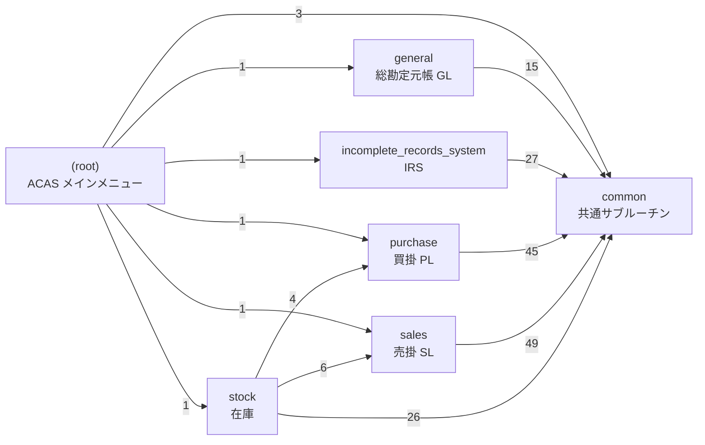

# 01. プログラム一覧と呼び出し関係

> 本書は `docs/migration/tools/gen_docs.py` により COBOL ソースから自動生成（手編集しない）。
> 抽出ルール: 静的 `CALL "x"` と、動的呼び出し `MOVE "x" TO ws-called` → `CALL ws-called`。 コメント（`*>`、固定形式 7 桁目 `*`）は除外。`experimental-stuff/` は対象外。

## 1. モジュール別サマリ

| モジュール | 役割 | プログラム数 | 行数 |
|---|---|---:|---:|
| `(root)` | ACAS メインメニュー | 1 | 779 |
| `common` | 共通サブルーチン | 15 | 10,088 |
| `sales` | 売掛 SL | 31 | 23,793 |
| `purchase` | 買掛 PL | 33 | 20,102 |
| `stock` | 在庫 | 12 | 14,860 |
| `general` | 総勘定元帳 GL | 17 | 11,873 |
| `incomplete_records_system` | IRS | 25 | 15,246 |

合計 134 プログラム / 96,741 行（うち `RW-Programs`/`RW-programs` の Report Writer 版・`.original` 等の派生 9 本を含む）。

## 2. モジュール依存図（モジュール間 CALL）

矢印のラベルは呼び出し元プログラム→呼び出し先プログラムの組の数。

## 3. メニュー → プログラム対応（エントリポイント）

`ACAS.cbl` と各サブシステムのメニューは選択文字 A–Z を `GO TO ... DEPENDING ON z` で段落に振り分け、段落内で `ws-called` に設定したプログラムを順に CALL する（`extract_menus.py`）。 IRS は画面セクションで 1–9/A を受け付け直接 CALL する（irs.cbl:405-455、手動抽出）。

### `ACAS.cbl`

| キー | メニュー表示 | 段落 | 呼び出しプログラム（順） |
|---|---|---|---|
| A | General Ledger | `load01` | `general` |
| B | Sales Ledger | `load02` | `sales` |
| C | Purchase Ledger | `load03` | `purchase` |
| D | Stock Control | `load04` | `stock` |
| E | Order Entry | `loadsr2` | （内部処理/未実装） |
| F | Payroll | `loadsr2` | （内部処理/未実装） |
| G | Epos | `loadsr2` | （内部処理/未実装） |
| X | Exit To system | `loaderror` | （内部処理/未実装） |
| Z | System Setup | `call-system-setup` | `sys002` |

### `sales/sales.cbl`

| キー | メニュー表示 | 段落 | 呼び出しプログラム（順） |
|---|---|---|---|
| A | Date Entry | `load01` | `sl000` |
| B | Customer File Maintenance | `load02` | `sl010` |
| C | Sales Ledger Enquiry | `load03` | `sl020` |
| D | Sales Transactions Input | `load04` | `sl910` |
| E | Sales Transactions Amend | `load05` | `sl920` |
| F | Sales Transactions Proof | `load06` | `sl050` |
| G | Sales Transactions Post | `load07` | `sl055` → `sl060` |
| H | Payment Input | `load08` | `sl080` |
| I | Payment Amend | `load09` | `sl085` |
| J | Payment Proof | `load10` | `sl090` → `sl095` |
| K | Payment Post | `load11` | `sl100` |
| L | Set-Up Sales Analysis Codes | `load12` | `sl070` |
| M | Sales Analysis Report | `load13` | `sl130` |
| N | Sales Day Book | `load14` | `sl140` |
| O | Statement Production | `load15` | `sl115` → `sl110` |
| P | Dunning Letters Generation | `load16` | `sl115` → `sl190` |
| Q | Aged Debtors Analysis | `load17` | `sl115` → `sl120` |
| R | Alphabetical Customer List | `load18` | `sl165` → `sl160` |
| S | Customer Turnover Report | `load19` | `sl180` |
| T | Invoice Sub-System | `load20` | `sl900` |
| U | End of Cycle Processing | `load21` | `sl140` → `xl150` → `sl130` |
| V | Customer File Dump | `load22` | `sl170` |
| X | Exit To | `loader` | （内部処理/未実装） |
| Z | System Setup | `call-system-setup` | `sys002` |

### `purchase/purchase.cbl`

| キー | メニュー表示 | 段落 | 呼び出しプログラム（順） |
|---|---|---|---|
| A | Date Entry | `load01` | `pl000` |
| B | Supplier File Maintenance | `load02` | `pl010` |
| C | Purchase Ledger Enquiry | `load03` | `pl015` |
| D | Purchase Transactions Input | `load04` | `pl020` |
| E | Purchase Transactions Amend | `load05` | `pl030` |
| F | Purchase Transactions Delete | `load06` | `pl040` |
| G | Purchase Transactions Proof | `load07` | `pl050` |
| H | Purchase Transactions Post | `load08` | `pl055` → `pl060` |
| I | Payment Input | `load09` | `pl080` |
| J | Payment Amend | `load10` | `pl085` |
| K | Payment Proof | `load11` | `pl090` → `pl095` |
| L | Payment Post | `load12` | `pl100` |
| M | Set-Up Purchase Analysis Codes | `load13` | `pl070` |
| N | Purchase Analysis Report | `load14` | `pl130` |
| O | Purchase Day Book | `load15` | `pl140` |
| P | Aged Creditors Report | `load16` | `pl165` → `pl115` → `pl120` |
| Q | Alphabetical Supplier List | `load17` | `pl165` → `pl160` |
| R | Supplier Turnover Report | `load18` | `pl170` |
| S | Cheque  Sub-System | `load19` | `pl900` |
| T | End Of Cycle Processing | `load20` | `pl140` → `xl150` → `pl130` |
| U | Invoice Parameter Amend | `load21` | `pl180` |
| V | Supplier File Dump | `load22` | `pl190` |
| X | Exit to | `loadre` | （内部処理/未実装） |
| Z | System Set Up | `call-system-setup` | `sys002` |

### `stock/stock.cbl`

| キー | メニュー表示 | 段落 | 呼び出しプログラム（順） |
|---|---|---|---|
| A | Date Entry | `load01` | `st000` |
| B | Stock Item Maintenance | `load02` | `st010` |
| C | Stock Movements | `load03` | `st020` |
| D | Reports | `load04` | `st030` |
| E | End of Cycle Processing | `load05` | `st040` |
| X | Exit to | `aa070-OverRewrite` | （内部処理/未実装） |
| Y | Stock File Compression | `load25` | `st050` |
| Z | System Set Up | `aa060-Call-System-Setup` | `sys002` |

### `general/general.cbl`

| キー | メニュー表示 | 段落 | 呼び出しプログラム（順） |
|---|---|---|---|
| A | Date Entry | `load01` | `gl000` |
| B | Chart Of Accounts | `load02` | `gl030` |
| C | Default Account Maintenance | `load03` | `gl020` |
| E | Enter Transactions | `load05` | `gl050` |
| F | Proof/Modify Transactions | `load06` | `gl051` |
| G | Batch Status Report | `load07` | `gl060` |
| H | Transaction Posting | `load08` | `gl070` → `gl071` → `gl072` |
| I | End Of Cycle Processing | `load09` | `gl080` |
| J | Print Trial Balance | `load10` | `gl090` |
| K | Print P&L and Balance Sheet | `load11` | `gl120` |
| L | Print Ledgers | `load12` | `gl100` → `gl105` |
| X | Exit to | `loader` | （内部処理/未実装） |
| Z | System Set Up | `call-system-setup` | `sys002` |

### `incomplete_records_system/irs.cbl`（手動抽出）

| キー | メニュー表示 | 呼び出しプログラム（順） |
|---|---|---|
| 1 | System Set-Up & Maintenance | 内部段落 `set-up` |
| 2 | Accounts Set-Up & Maintenance | `irs010` |
| 3 | Default A/Cs Set-Up & Maintenance | `irs020` |
| 4 | Posting | `irs030` |
| 5 | Trial Balance | `irs040` |
| 6 | Audit Trail | `irs050` |
| 7 | Accounts Production | `irs065` → `irs060` |
| 8 | Posting Amendments | `irs070` |
| 9 | Analysis Report | `irs085` → `irs090` |
| A | Nominal File Fix up | `irs080` |
| \| | （テスト用：任意プログラム名を入力して CALL） | `call-prog` 動的 — **移植しない**（任意モジュール実行） |

### サブメニュー

| 親 | 呼び出し先 | 備考 |
|---|---|---|
| `sales/sl900.cbl` (Invoice Sub-System) | `sl200`, `sl910`, `sl920`, `sl930`, `sl940`, `sl950` | 請求書サブシステム |
| `purchase/pl900.cbl` (Cheque Sub-System) | `maps04`, `pl910`, `pl920`, `pl930`, `pl940`, `pl950`, `pl960` | 小切手/支払サブシステム |
| `purchase/pl180.cbl` (Invoice Parameter Amend) | `pl020`, `pl030`, `pl040`, `pl050` | |
| `general/gl090.cbl` (Trial Balance) | `gl090a`, `gl090b` | |

## 4. 全プログラム一覧

凡例: **S**=SCREEN SECTION 使用、**P**=印刷（`selprint`/print-spool）使用。ファイル列は COPY している `sel*.cob`（IRS は irsub* 経由でファイルアクセスするため空欄が多い）。

### (root) — ACAS メインメニュー

| プログラム | 行数 | 段落数 | S/P | 使用ファイル (sel) | CALL 先 |
|---|---:|---:|---|---|---|
| `ACAS.cbl` | 779 | 36 | -- | selsys | `epos`⚠, `general`, `irs`, `maps01`, `maps04`, `OE`⚠, `payroll`⚠, `purchase`, `sales`, `stock`, `sys002` |

### common — 共通サブルーチン

| プログラム | 行数 | 段落数 | S/P | 使用ファイル (sel) | CALL 先 |
|---|---:|---:|---|---|---|
| `common/acas011.cbl` | 521 | 14 | -- | selstock | `stockMT` |
| `common/irsub1.cbl` | 254 | 14 | -- |  |  |
| `common/irsub3.cbl` | 111 | 3 | -- |  |  |
| `common/irsub4.cbl` | 221 | 13 | -- |  |  |
| `common/irsub5.cbl` | 134 | 2 | -- |  |  |
| `common/maps01.cbl` | 198 | 10 | -- |  |  |
| `common/maps04.cbl` | 176 | 3 | -- |  |  |
| `common/maps09.cbl` | 133 | 5 | -- |  |  |
| `common/maps51.cbl` | 254 | 14 | -- |  |  |
| `common/maps99.cbl` | 182 | 5 | -- |  |  |
| `common/mapser.cbl` | 405 | 0 | -- | selsys | `maps01` |
| `common/mapserup.cbl` | 377 | 1 | -- | selsys | `maps01` |
| `common/stockMT.cbl` | 3478 | 69 | -- |  | `GETInstanceStamp`⚠, `HandleDB`⚠, `LogIt`⚠, `STOCKMTclose`⚠, `STOCKMTdelete`⚠, `STOCKMTgetnext`⚠, `STOCKMTGetRandom`⚠, `STOCKMTinit`⚠, `STOCKMTstart`⚠, `STOCKMTStart`⚠, `STOCKMTupdate`⚠, `STOCKMTwrite`⚠, `TranslateFileStatus`⚠ |
| `common/sys002.cbl` | 2445 | 38 | SP | selprint, selsys | `maps01`, `maps04`, *SYSTEM* |
| `common/xl150.cbl` | 1199 | 61 | -- | selinv, seloi3, seloi5, selois, selpinv, selpl, selsl, selval | `maps01`, `maps04`, `maps99` |

### sales — 売掛 SL

| プログラム | 行数 | 段落数 | S/P | 使用ファイル (sel) | CALL 先 |
|---|---:|---:|---|---|---|
| `sales/sales.cbl` | 985 | 51 | -- | selsys | *CBL_CHECK_FILE_EXIST*, `maps01`, `maps04`, `maps99`, `sl000`, `sl010`, `sl020`, `sl050`, `sl055`, `sl060`, `sl070`, `sl080`, `sl085`, `sl090`, `sl095`, `sl100`, `sl110`, `sl115`, `sl120`, `sl130`, `sl140`, `sl160`, `sl165`, `sl170`, `sl180`, `sl190`, `sl900`, `sl910`, `sl920`, `sys002`, *SYSTEM*, `xl150` |
| `sales/sl000.cbl` | 266 | 5 | -- |  | `maps01`, `maps04`, `maps99` |
| `sales/sl010.cbl` | 1885 | 50 | SP | seldel, selprint, selsl | `maps04`, `maps09`, `maps99`, *SYSTEM* |
| `sales/sl020.cbl` | 923 | 33 | SP | selinv, seloi3, selprint, selsl | `maps04`, `maps99`, *SYSTEM* |
| `sales/sl050.cbl` | 739 | 12 | -P | selinv, selprint, selsl | `maps04`, *SYSTEM* |
| `sales/sl055.cbl` | 587 | 13 | -- | selanal, selinv, seloi2, selval | `maps99`, `sl070` |
| `sales/sl060.cbl` | 1158 | 32 | -P | selbatch, seloi2, seloi3, selpost-irs, selpost, selprint, selsl, selval | `maps04`, *SYSTEM* |
| `sales/sl070.cbl` | 768 | 28 | -P | selanal, selprint, selval | *SYSTEM* |
| `sales/sl080.cbl` | 803 | 28 | S- | seloi3, selsl | `maps04`, `maps99` |
| `sales/sl085.cbl` | 628 | 26 | S- | seloi3, selsl | `maps04`, `maps99` |
| `sales/sl090.cbl` | 202 | 4 | -- | seloi3, selois | `maps99` |
| `sales/sl095.cbl` | 528 | 11 | -P | selois, selprint, selsl | `maps04`, *SYSTEM* |
| `sales/sl100.cbl` | 734 | 15 | -P | selbatch, seloi3, selpost-irs, selpost, selprint, selsl, selval | `maps04`, `maps99`, *SYSTEM* |
| `sales/sl110.cbl` | 861 | 20 | -P | selois, selprint, selsl | `maps04`, `maps99`, *SYSTEM* |
| `sales/sl115.cbl` | 162 | 4 | -- | seloi3, selois | `maps99` |
| `sales/sl120.cbl` | 1052 | 27 | -P | selois, selprint, selsl | `maps04`, `maps99`, *SYSTEM* |
| `sales/sl130.cbl` | 412 | 12 | -P | selprint, selval | `maps04`, *SYSTEM* |
| `sales/sl140.cbl` | 463 | 9 | -P | selinv, selprint, selsl | `maps04`, *SYSTEM* |
| `sales/sl160.cbl` | 797 | 15 | SP | seldel, selprint, selsl | `maps04`, *SYSTEM* |
| `sales/sl165.cbl` | 151 | 4 | -- | selsl |  |
| `sales/sl170.cbl` | 796 | 14 | SP | selprint, selsl | `maps04`, *SYSTEM* |
| `sales/sl180.cbl` | 623 | 15 | SP | selprint, selsl | `maps04`, *SYSTEM* |
| `sales/sl190.cbl` | 661 | 22 | -- | seloi3, selsl | `maps04`, `maps99` |
| `sales/sl200.cbl` | 288 | 9 | -P | seldnos, selprint | `maps04`, *SYSTEM* |
| `sales/sl900.cbl` | 419 | 14 | -- |  | `sl200`, `sl910`, `sl920`, `sl930`, `sl940`, `sl950` |
| `sales/sl910.cbl` | 2049 | 64 | S- | selanal, selaud, seldel, seldnos, selinv, seloi3, selsl, selstock | `maps04`, `maps99`, `sl070`, `sl930`, `sl960` |
| `sales/sl920.cbl` | 2113 | 56 | S- | selanal, selaud, seldel, selinv, selsl, selstock | `maps04`, `maps99`, `sl070` |
| `sales/sl930.cbl` | 996 | 21 | -P | seldel, selinv, selprint, selsl | `maps04`, `maps99`, *SYSTEM* |
| `sales/sl940.cbl` | 431 | 11 | -- | seldel, seldnos, selinv, selsl | `maps04`, `maps99` |
| `sales/sl950.cbl` | 833 | 17 | -P | seldel, selinv, selprint, selsl, selstock | `maps04`, `maps99`, *SYSTEM* |
| `sales/sl960.cbl` | 480 | 13 | S- | seldel, selsl | `maps09`, `maps99` |

### purchase — 買掛 PL

| プログラム | 行数 | 段落数 | S/P | 使用ファイル (sel) | CALL 先 |
|---|---:|---:|---|---|---|
| `purchase/pl000.cbl` | 270 | 5 | -- |  | `maps01`, `maps04`, `maps99` |
| `purchase/pl010.cbl` | 1527 | 44 | SP | seldel, selpl, selprint | `maps04`, `maps09`, `maps99`, *SYSTEM* |
| `purchase/pl015.cbl` | 914 | 32 | SP | seloi5, selpinv, selpl, selprint | `maps04`, `maps99`, *SYSTEM* |
| `purchase/pl020.cbl` | 1192 | 39 | S- | selanal, selpdnos, selpinv, selpl | `maps04`, `maps99`, `pl025` |
| `purchase/pl025.cbl` | 375 | 9 | S- | seldel, selpl | `maps09`, `maps99` |
| `purchase/pl030.cbl` | 1129 | 37 | S- | selanal, selpinv, selpl | `maps04`, `maps99` |
| `purchase/pl040.cbl` | 393 | 8 | -- | selpdnos, selpinv, selpl | `maps04`, `maps99` |
| `purchase/pl050.cbl` | 598 | 10 | -P | selpinv, selpl, selprint | `maps04`, *SYSTEM* |
| `purchase/pl055.cbl` | 485 | 7 | -- | selanal, seloi4, selpinv, selval | `maps99` |
| `purchase/pl060.cbl` | 1007 | 16 | -P | selbatch, seloi4, seloi5, selpl, selpost-irs, selpost, selprint | `maps04`, *SYSTEM* |
| `purchase/pl070.cbl` | 782 | 28 | -P | selanal, selprint, selval | *SYSTEM* |
| `purchase/pl080.cbl` | 774 | 28 | S- | seloi5, selpl | `maps04`, `maps99` |
| `purchase/pl085.cbl` | 614 | 26 | S- | seloi5, selpl | `maps04`, `maps99` |
| `purchase/pl090.cbl` | 184 | 4 | -- | seloi5, selois | `maps99` |
| `purchase/pl095.cbl` | 523 | 11 | -P | selois, selpl, selprint | `maps04`, *SYSTEM* |
| `purchase/pl100.cbl` | 732 | 15 | -P | selbatch, seloi5, selpl, selpost-irs, selpost, selprint, selval | `maps04`, `maps99`, *SYSTEM* |
| `purchase/pl115.cbl` | 164 | 4 | -- | seloi5, selois | `maps99` |
| `purchase/pl120.cbl` | 1076 | 29 | -P | selois, selpl, selprint | `maps04`, `maps99`, *SYSTEM* |
| `purchase/pl130.cbl` | 409 | 12 | -P | selprint, selval | `maps04`, *SYSTEM* |
| `purchase/pl140.cbl` | 444 | 9 | -P | selpinv, selpl, selprint | `maps04`, *SYSTEM* |
| `purchase/pl160.cbl` | 708 | 12 | SP | selpl, selprint | `maps04`, *SYSTEM* |
| `purchase/pl165.cbl` | 161 | 6 | -- | selpl |  |
| `purchase/pl170.cbl` | 612 | 14 | SP | selpl, selprint | `maps04`, *SYSTEM* |
| `purchase/pl180.cbl` | 209 | 9 | -- |  | `pl020`, `pl030`, `pl040`, `pl050` |
| `purchase/pl190.cbl` | 730 | 14 | SP | selpl, selprint | `maps04`, *SYSTEM* |
| `purchase/pl900.cbl` | 220 | 8 | -- |  | `maps04`, `pl910`, `pl920`, `pl930`, `pl940`, `pl950`, `pl960` |
| `purchase/pl910.cbl` | 568 | 12 | -P | seloi5, selpay, selpl, selprint | `maps04`, *SYSTEM* |
| `purchase/pl920.cbl` | 290 | 9 | -- | selpay, selpl |  |
| `purchase/pl930.cbl` | 428 | 10 | -P | selpay, selpl, selprint | `maps04`, *SYSTEM* |
| `purchase/pl940.cbl` | 559 | 9 | -- | selpay, selpl | `maps04` |
| `purchase/pl950.cbl` | 738 | 15 | -P | selbatch, seloi5, selpay, selpl, selpost-irs, selpost, selprint, selval | `maps04`, *SYSTEM* |
| `purchase/pl960.cbl` | 280 | 3 | -P | selprint | *SYSTEM* |
| `purchase/purchase.cbl` | 1007 | 52 | -- | selsys | *CBL_CHECK_FILE_EXIST*, `maps01`, `maps04`, `maps99`, `pl000`, `pl010`, `pl015`, `pl020`, `pl030`, `pl040`, `pl050`, `pl055`, `pl060`, `pl070`, `pl080`, `pl085`, `pl090`, `pl095`, `pl100`, `pl115`, `pl120`, `pl130`, `pl140`, `pl160`, `pl165`, `pl170`, `pl180`, `pl190`, `pl900`, `sys002`, *SYSTEM*, `xl150` |

### stock — 在庫

| プログラム | 行数 | 段落数 | S/P | 使用ファイル (sel) | CALL 先 |
|---|---:|---:|---|---|---|
| `stock/RW-Programs/st010.cbl` | 1943 | 58 | SP | selanal, selpl, selprint, selstock | `maps04`, `maps09`, `maps99`, `pl010`, `sl070`, *SYSTEM* |
| `stock/RW-Programs/st010.original.cbl` | 1944 | 58 | SP | selanal, selpl, selprint, selstock | `maps04`, `maps09`, `maps99`, `pl010`, `sl070`, *SYSTEM* |
| `stock/RW-Programs/st010Rep.cbl` | 2652 | 58 | S- |  | `maps04`, `maps09`, `maps99`, `pl010`, `sl070`, *SYSTEM* |
| `stock/acasconvert1.cbl` | 284 | 3 | -- | selsys |  |
| `stock/st000.cbl` | 264 | 5 | -- |  | `maps01`, `maps04`, `maps99` |
| `stock/st010.cbl` | 1853 | 58 | SP | selanal, selpl, selprint, selstock | `maps04`, `maps09`, `maps99`, `pl010`, `sl070`, *SYSTEM* |
| `stock/st020.cbl` | 1977 | 57 | -P | selaud, selprint, selstock | `maps04`, `maps99`, *SYSTEM* |
| `stock/st030.cbl` | 1773 | 42 | SP | selprint, selstock | `maps04`, `maps99`, *SYSTEM* |
| `stock/st040.cbl` | 294 | 8 | -- | selstock | `maps99` |
| `stock/st050.cbl` | 398 | 11 | -- | selstock | `maps99` |
| `stock/st060.cbl` | 680 | 21 | -- | selstock | `maps04`, `sl070` |
| `stock/stock.cbl` | 798 | 29 | -- | selsys | *CBL_CHECK_FILE_EXIST*, `maps01`, `maps04`, `maps99`, `sl070`, `st000`, `st010`, `st020`, `st030`, `st040`, `st050`, `st060`, `sys002`, *SYSTEM* |

### general — 総勘定元帳 GL

| プログラム | 行数 | 段落数 | S/P | 使用ファイル (sel) | CALL 先 |
|---|---:|---:|---|---|---|
| `general/general.cbl` | 953 | 40 | -- | selsys | *CBL_CHECK_FILE_EXIST*, `gl000`, `gl020`, `gl030`, `gl050`, `gl051`, `gl060`, `gl070`, `gl071`, `gl072`, `gl080`, `gl090`, `gl100`, `gl105`, `gl120`, `gl210`⚠, `maps01`, `maps04`, `maps99`, `sys002` |
| `general/gl000.cbl` | 264 | 4 | -- |  | `maps01`, `maps04`, `maps99` |
| `general/gl020.cbl` | 721 | 21 | -- | seledger | `maps01`, `maps04` |
| `general/gl030.cbl` | 2188 | 103 | -P | seledger, selprint | `maps04`, *SYSTEM* |
| `general/gl050.cbl` | 1643 | 82 | -- | selbatch, seledger, selpost | `maps04` |
| `general/gl051.cbl` | 1201 | 48 | -P | selbatch, seledger, selpost, selprint | `maps04`, *SYSTEM* |
| `general/gl060.cbl` | 473 | 14 | -P | selbatch, selprint | `maps04`, *SYSTEM* |
| `general/gl070.cbl` | 553 | 17 | -- | selbatch, selpost | `maps04` |
| `general/gl071.cbl` | 147 | 2 | -- |  |  |
| `general/gl072.cbl` | 431 | 9 | -P | selbatch, seledger, selprint | *SYSTEM* |
| `general/gl080.cbl` | 640 | 21 | -- | selbatch, seledger, selpost |  |
| `general/gl090.cbl` | 184 | 3 | -- |  | `gl090a`, `gl090b` |
| `general/gl090a.cbl` | 584 | 11 | -P | seledger, selprint | *SYSTEM* |
| `general/gl090b.cbl` | 376 | 6 | -P | seledger, selprint | *SYSTEM* |
| `general/gl100.cbl` | 250 | 3 | -- |  |  |
| `general/gl105.cbl` | 521 | 18 | -P | seledger, selprint | *SYSTEM* |
| `general/gl120.cbl` | 744 | 21 | -P | seledger, selprint | `maps04`, *SYSTEM* |

### incomplete_records_system — IRS

| プログラム | 行数 | 段落数 | S/P | 使用ファイル (sel) | CALL 先 |
|---|---:|---:|---|---|---|
| `incomplete_records_system/RW-programs/irs010.cbl` | 1188 | 47 | SP |  | *CBL_CHECK_FILE_EXIST*, `irsub1`, *SYSTEM* |
| `incomplete_records_system/RW-programs/irs020.cbl` | 850 | 20 | SP |  | `irsub1`, `irsub3`, `irsub5`, *SYSTEM* |
| `incomplete_records_system/RW-programs/irs040.cbl` | 577 | 21 | -P |  | `irsub1`, *SYSTEM* |
| `incomplete_records_system/RW-programs/irs050-rw.cbl` | 1334 | 48 | -P |  | `irs055`, `irsub1`, `irsub3`, `irsubp`, *SYSTEM* |
| `incomplete_records_system/RW-programs/irs090.cbl` | 406 | 14 | -P |  | *SYSTEM* |
| `incomplete_records_system/RW-programs/irs090Rep.cbl` | 519 | 14 | -- |  | *SYSTEM* |
| `incomplete_records_system/irs.cbl` | 708 | 11 | S- |  | *CBL_CHECK_FILE_EXIST*, `irs010`, `irs020`, `irs030`, `irs040`, `irs050`, `irs060`, `irs065`, `irs070`, `irs080`, `irs085`, `irs090`, `irsub2`, `maps04`, *SYSTEM* |
| `incomplete_records_system/irs010.cbl` | 1196 | 47 | SP |  | *CBL_CHECK_FILE_EXIST*, `irsub1`, *SYSTEM* |
| `incomplete_records_system/irs020.cbl` | 853 | 20 | SP |  | `irsub1`, `irsub3`, `irsub5`, *SYSTEM* |
| `incomplete_records_system/irs030.cbl` | 1390 | 45 | S- | selpost-irs | `irsub1`, `irsub2`, `irsub3`, `irsub4` |
| `incomplete_records_system/irs040.cbl` | 555 | 22 | -P |  | `irsub1`, *SYSTEM* |
| `incomplete_records_system/irs050.cbl` | 1283 | 48 | -P |  | `irs055`, `irsub1`, `irsub3`, `irsubp`, *SYSTEM* |
| `incomplete_records_system/irs055.cbl` | 165 | 4 | -- |  |  |
| `incomplete_records_system/irs060.cbl` | 1468 | 56 | -P |  | *C$JUSTIFY*, `irsub3`, `irsub4`, *SYSTEM* |
| `incomplete_records_system/irs065.cbl` | 148 | 3 | -- |  |  |
| `incomplete_records_system/irs070.cbl` | 717 | 20 | -- |  | `irs055`, `irsub1`, `irsub2`, `irsub3`, `irsub4`, `irsubp` |
| `incomplete_records_system/irs080.cbl` | 308 | 7 | -- |  | `irsub1`, `irsub3`, `irsub4` |
| `incomplete_records_system/irs085.cbl` | 161 | 3 | -- |  | `irsub3` |
| `incomplete_records_system/irs090.cbl` | 409 | 15 | -P |  | *SYSTEM* |
| `incomplete_records_system/irsub1.cbl` | 269 | 14 | -- |  |  |
| `incomplete_records_system/irsub2.cbl` | 125 | 5 | -- |  |  |
| `incomplete_records_system/irsub3.cbl` | 111 | 3 | -- |  |  |
| `incomplete_records_system/irsub4.cbl` | 221 | 13 | -- |  |  |
| `incomplete_records_system/irsub5.cbl` | 134 | 2 | -- |  |  |
| `incomplete_records_system/irsubp.cbl` | 151 | 6 | -- |  |  |

⚠ = 呼び出し先がリポジトリに存在しない（`OE`/`payroll`/`epos` はオープンソース版で除外、`gl210` は未提供、`stockMT` 内の `HandleDB` 等は RDB DAL（未収録）。*斜体* = ランタイム/ライブラリ呼び出し。

