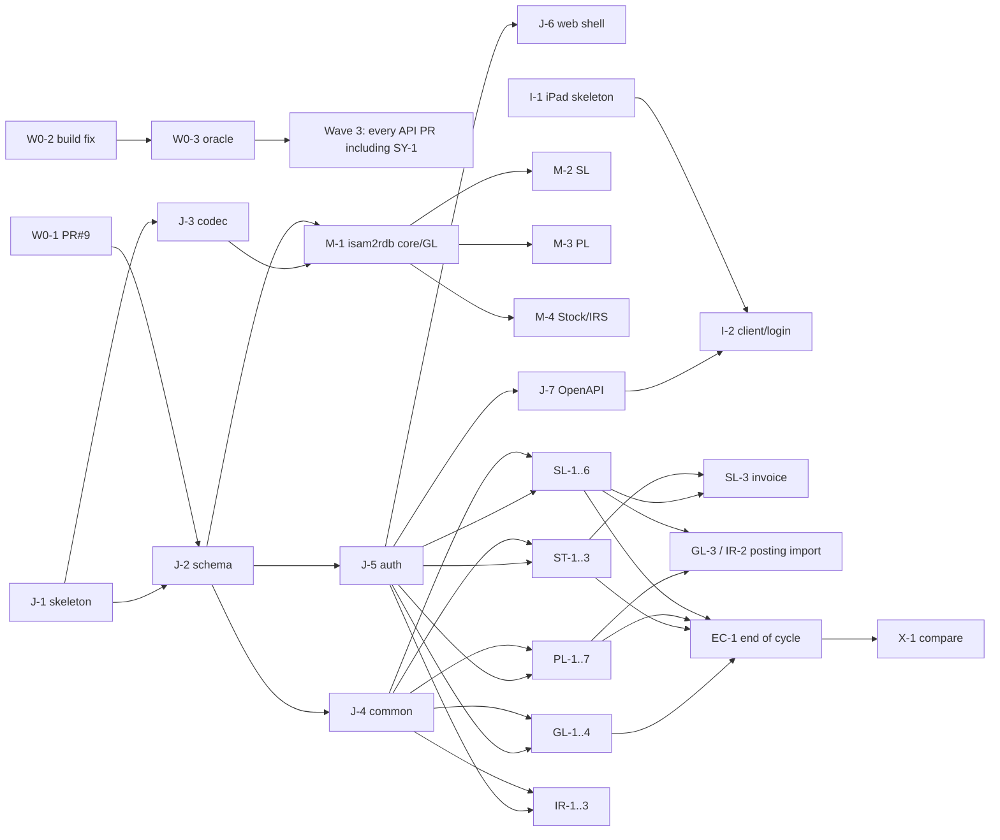

# ACAS → Java Web / iPad 移行 PR 分割計画

対象: `madmerger/ACAS`（GnuCOBOL 3.01.07 系、134 プログラム / 約 9.7 万行、28 論理ファイル）。
目的: 「Java ウェブアプリ」と「iPad アプリ」へ移行する作業を、**単独でマージしても main が壊れない小さな PR** に分割し、依存関係と並列可能な範囲を示す。本書は計画のみで、実装は含まない。

前提資料: 設計の土台は未マージの [PR #9 Phase 0（分析・設計）](https://github.com/madmerger/ACAS/pull/9)（プログラム一覧・メニュー対応表・ファイルレイアウト・43 テーブルの DDL・型対応）と、マージ済みの `docs/business-requirements-as-is.md`（業務ルール SL-/PL-/ST-xx）。

## 1. 現状マップ（要約）

| モジュール | 入口 | 機能（メニュー項目） | 本数 / 行数 | 主な共有ファイル |
|---|---|---|---|---|
| 共通 | `ACAS.cbl`、`sys002`、`maps01/04/09`、`xl150`、`acas011`/`irsub*` | メインメニュー、システム設定、日付・チェックデジット・パスワード、期末処理、ファイルハンドラ | 16 / 10.9k | `system.dat`（全モジュール） |
| 売掛 SL | `sales.cbl` | A–V の 22 項目 + 請求書サブシステム `sl900` | 31 / 23.8k | `stockctl`、`value`/`analysis`、`delivery`、`batch`/`posting`、`postings2irs`、`staudit` |
| 買掛 PL | `purchase.cbl` | A–V の 22 項目 + 小切手サブシステム `pl900` | 33 / 20.1k | `purchled`、`value`/`analysis`、`delivery`、`batch`/`posting`、`postings2irs` |
| 在庫 | `stock.cbl` | A–E, Y の 6 項目 | 12 / 14.9k | `stockctl`、`staudit`、`purchled`（参照） |
| 総勘定元帳 GL | `general.cbl` | A–L の 11 項目 | 17 / 11.9k | `ledger`、`batch`/`posting`（SL/PL から受信） |
| IRS | `irs.cbl` | 1–9, A の 10 項目（`\|` 任意 CALL は移植しない） | 25 / 15.2k | `postings2irs`（SL/PL から受信） |

- UI は端末画面（SCREEN SECTION 32 本）、帳票は `lpr` スプール（61 本）。Web/iPad では画面 = HTML / SwiftUI、帳票 = PDF/CSV ダウンロードに置き換える。
- データは ISAM/RELATIVE/SEQUENTIAL のバイナリ（COMP-3・BE COMP・LE BINARY 混在）。RDB 版 DAL は在庫だけで、その先のモジュールはリポジトリに無い。
- メインメニューの E/F/G（Order Entry / Payroll / Epos）は未実装のため移行対象外。
- 平文パスワード（`Pass-Word x(4)`、`RDBMS-Passwd`）は移行せず、ハッシュ化した利用者テーブルと環境変数に置き換える。

## 2. 方針（この計画で採った既定値）

| 項目 | 既定値 | 理由 |
|---|---|---|
| 移行方式 | 全面書き換え（モジュール順に実装・比較検証、本番切替は一括） | PR #9 の推奨。ISAM⇔RDB 双方向同期は会計データの整合性リスクが大きい |
| バックエンド | Java 21 + Spring Boot 3、Maven マルチモジュール、PostgreSQL（テストは Testcontainers / H2）、Flyway | PR #9 の設計どおり |
| Web | 同じ Spring Boot アプリ内の Spring MVC + Thymeleaf（htmx 可）。サービス層を API と共有 | 「Java のウェブアプリ」の要件を Java だけで満たし、別フロントのビルド基盤を増やさない |
| iPad | SwiftUI ネイティブアプリ（iPadOS 17+）、Java の REST API（OpenAPI 3）を利用。ビルド・テストは macOS セッション | iPad 専用の操作性（Split View、ハードウェアキーボードのショートカット） |
| API | `/api/v1/...`、OpenAPI を Java 側で生成し、iPad クライアントはその仕様から生成 | Web と iPad で業務ロジックを二重実装しない |
| 認証 | Spring Security。Web はセッション、iPad は短命 JWT + リフレッシュ。パスワードは bcrypt/PBKDF2 | 平文パスワードの廃止 |
| 画面の保持 | メニューのキー文字・階層・画面タイトル・入力順・エラーコード（SY/SL/PL/GL/ST/IR）はレガシーどおり、表示は日本語 | 利用者の操作手順を変えない |
| 正解（オラクル） | GnuCOBOL でビルドしたレガシーに共通 `cases.json` を流し、Java の結果と機械比較 | 期待値を推測にしない |
| 配置 | `java/`、`ipad/`、`tools/oracle/`、`tools/isam2rdb/` を追加。COBOL ソースは変更しない | 各 PR が既存のビルドに影響しない |

「単独でマージしても安全」の条件: 新しいディレクトリへの追加だけで COBOL のビルドを変えない／各 PR が自前のテストと CI ジョブを通す／未完成の機能はメニューに出さない（メニュー項目は機能 PR で有効化）。

## 3. PR 一覧

ID は本計画内の通し番号。「依存」の PR がマージ済みなら着手できる。同じ Wave 内で依存が無いものは並列に進められる。

### Wave 0 — 前提（並列可）

| ID | PR | 内容 | 依存 |
|---|---|---|---|
| W0-1 | Phase 0 設計のマージ | 既存 [PR #9](https://github.com/madmerger/ACAS/pull/9) をレビュー・マージ（移行方式の最終判断もここ） | – |
| W0-2 | GnuCOBOL 3.x ビルド修正 | 既存 [PR #1](https://github.com/madmerger/ACAS/pull/1) / [PR #8](https://github.com/madmerger/ACAS/pull/8) を整理して 1 本にし、`wsfnctn.cob` の `binary-long unsigned` 修正を含める | – |
| W0-3 | レガシー・オラクル基盤 | `tools/oracle/`: ビルド→ベースラインデータ投入→`cases.json` を端末操作（pexpect）で実行→出力ファイル/帳票を JSON 化。CI ジョブ追加 | W0-2 |

### Wave 1 — Java 基盤

| ID | PR | 内容 | 依存 |
|---|---|---|---|
| J-1 | Java プロジェクト雛形 | `java/` Maven マルチモジュール（`acas-core`/`acas-app`/`acas-isam`）、ヘルスチェック、GitHub Actions（build + test） | – |
| J-2 | DB スキーマ | Flyway `V1__init.sql`（PR #9 の DDL）、JPA エンティティ + リポジトリ（共通・GL・SL・PL・在庫・IRS）、起動テスト | J-1, W0-1 |
| J-3 | COBOL 型 codec | COMP-3 / BE COMP / LE BINARY / ゾーン 10 進 / 整数日付の読み書き、`ROUNDED` 無し＝切り捨ての演算ヘルパ。単体テスト | J-1 |
| J-4 | 共通サービス | `maps04`（日付）、`maps09`（チェックデジット）、エラーコード台帳（`common/error.txt` 等）、システム設定（`sys002` の読み書き API） | J-2 |
| J-5 | 認証・利用者 | Spring Security、利用者テーブル、ハッシュ化、Web セッション / API JWT、ログイン試行制限 | J-2 |
| J-6 | Web シェル | Thymeleaf レイアウト、ログイン画面、`ACAS.cbl` のメインメニュー（A–D, Z）と各サブメニューの枠（未実装項目は非表示）、日本語メッセージ | J-5 |
| J-7 | OpenAPI 公開 | springdoc で `/api/v1` 仕様を生成し、`api/openapi.yaml` を CI で差分検証 | J-5 |
| M-1 | ISAM→RDB 移行ツール: 共通・GL | `tools/isam2rdb`（Java CLI、J-3 の codec を使用）で `system.dat`・`ledger`・`batch`・`posting`・`archive.dat`（GL 元帳印刷の履歴）を移行。往復テスト | J-2, J-3 |
| M-2 | 同: SL | `salesled`・`invoice`・`openitm2/3`・`delinvno`・`value`/`analysis`/`delivery` | M-1 |
| M-3 | 同: PL | `purchled`・`pinvoice`・`openitm4/5`・`delfolio`・`pay` | M-1 |
| M-4 | 同: 在庫・IRS | `stockctl`・`staudit`・IRS 5 ファイル・`postings2irs.dat`（SL/PL から IRS への未取込転記） | M-1 |

M-2 / M-3 / M-4 は並列可。J-3 は J-2 と並列可。

切替ではレガシーへの書込みを停止し、`postings2irs.dat` の未取込レコードを M-4 で未処理キューとして保存する。IR-2 が切替後に一度だけ取り込み、移行時には元帳へ転記しない。ファイル識別子とレコード位置による一意な移行 ID・処理済み状態を保持し、移行再実行・取込再試行による二重計上を防ぐ。件数・金額を移行前後および取込後に照合し、差異があれば切替を止める。元ファイルは照合完了まで保全する。

### Wave 2 — iPad 基盤（Wave 1 と並列で開始可）

| ID | PR | 内容 | 依存 |
|---|---|---|---|
| I-1 | iPad アプリ雛形 | `ipad/` SwiftUI プロジェクト、XCTest、macOS の CI ジョブ（Xcode ビルド + シミュレータテスト） | – |
| I-2 | API クライアント・ログイン | OpenAPI から Swift クライアント生成、ログイン / トークン保管（Keychain）、メインメニュー | I-1, J-7 |

### Wave 3 — 業務機能（モジュールごとに API → Web 画面 / iPad 画面）

各機能は原則 3 本の PR に分ける: **API**（サービス + REST + オラクル比較テスト） → **Web 画面** と **iPad 画面**（この 2 本は並列）。帳票系は API が PDF/CSV を返し、Web/iPad はダウンロード・表示のみ。

全 Wave 3 API PR の共通依存は **W0-3**（レガシー・オラクルのベースライン）。以下の「API の依存」列は、この共通依存に追加する個別依存を示す。SY-1 の設定 API も例外ではない。

| ID | 機能（レガシーのメニュー） | レガシー | API の依存（全行 W0-3 が前提） |
|---|---|---|---|
| SL-1 | 日付入力・顧客マスタ・元帳照会（A, B, C） | `sl000`, `sl010`, `sl020` | J-4, J-5 |
| SL-2 | 分析コード設定（L） | `sl070` | J-4 |
| SL-3 | 売上取引の入力・訂正（D, E、請求書サブシステム T） | `sl910`, `sl920`, `sl900`/`sl930`–`sl950` | SL-1, SL-2, ST-1 |
| SL-4 | 売上取引のプルーフ・転記（F, G）→ `batch`/`posting`/`postings2irs` | `sl050`, `sl055`, `sl060` | SL-3 |
| SL-5 | 入金の入力・訂正・プルーフ・転記（H–K） | `sl080`–`sl100` | SL-4 |
| SL-6 | 帳票: 分析・売上日記帳・請求書明細・督促状・年齢分析・顧客一覧・売上高（M–S, V） | `sl110`–`sl190` | SL-5 |
| PL-1 | 日付入力・仕入先マスタ・元帳照会（A, B, C） | `pl000`, `pl010`, `pl015` | J-4, J-5 |
| PL-2 | 分析コード設定・請求書パラメータ（M, U） | `pl070`, `pl180` | J-4 |
| PL-3 | 仕入取引の入力・訂正・削除（D, E, F） | `pl020`–`pl040` | PL-1, PL-2 |
| PL-4 | 仕入取引のプルーフ・転記（G, H） | `pl050`–`pl060` | PL-3 |
| PL-5 | 支払の入力・訂正・プルーフ・転記（I–L） | `pl080`–`pl100` | PL-4 |
| PL-6 | 小切手・BACS サブシステム（S） | `pl900`–`pl960` | PL-5 |
| PL-7 | 帳票: 分析・仕入日記帳・年齢分析・仕入先一覧・仕入高・ダンプ（N–R, V） | `pl115`–`pl190` | PL-5 |
| ST-1 | 在庫品目マスタ（B）・日付入力（A） | `st000`, `st010` | J-4, J-5 |
| ST-2 | 入出庫（C）・監査記録 | `st020` | ST-1 |
| ST-3 | 帳票（D）・ファイル圧縮（Y） | `st030`, `st050` | ST-2 |
| GL-1 | 日付・勘定科目・既定勘定（A, B, C） | `gl000`, `gl030`, `gl020` | J-4, J-5 |
| GL-2 | 仕訳入力・プルーフ/修正・バッチ状況（E, F, G） | `gl050`, `gl051`, `gl060` | GL-1 |
| GL-3 | 転記（H）— SL/PL の `batch`/`posting` 取込を含む | `gl070`–`gl072` | GL-2, SL-4, PL-4 |
| GL-4 | 試算表・損益/貸借・元帳印刷（J, K, L） | `gl090`(a/b), `gl120`, `gl100`, `gl105` | GL-3 |
| IR-1 | システム・勘定・既定勘定設定（1, 2, 3, A） | `irs` 内部, `irs010`, `irs020`, `irs080` | J-4, J-5 |
| IR-2 | 転記・転記修正（4, 8）— SL/PL からの `postings2irs` 取込を含む | `irs030`, `irs070` | IR-1, SL-4, PL-4 |
| IR-3 | 試算表・監査証跡・決算書・分析（5, 6, 7, 9） | `irs040`–`irs090` | IR-2 |
| EC-1 | 期末処理（SL U・PL T・在庫 E・GL I） | `xl150`, `st040`, `gl080` | SL-6, PL-7, ST-3, GL-4 |
| SY-1 | システム設定画面（各メニュー Z） | `sys002` | J-4（Web/iPad 画面は J-6/I-2 後） |

ST-1 は PL-1 / SL-2 / PL-2 の画面・API を待たずにマージする。`stock/st010.cbl` は非空の仕入先を仕入先マスタで、非空の分析コードを P/S 別の分析マスタで検証するため、J-2 のリポジトリを使う参照検証を ST-1 に含める。比較テストでは W0-3 の同一フィクスチャから仕入先と P/S 分析コードをレガシー・Java の両方へ事前投入し、有効値・空欄・存在しない値（ST101 / ST110 / ST111）を検証する。これはテスト用データ投入であり、本番での検証省略や架空マスタ作成は行わない。本番の参照マスタは M-2 / M-3 で移行する。

### Wave 4 — 切替準備

| ID | PR | 内容 | 依存 |
|---|---|---|---|
| X-1 | 全体比較テスト | 全 `cases.json` をレガシーと Java で実行し、相違一覧と対処履歴をレポート化 | Wave 3 全部 |
| X-2 | 運用 | Docker イメージ、`acasbkup.sh` 相当の DB バックアップ、移行リハーサル手順書 | M-2–M-4, X-1 |
| X-3 | iPad 配布 | TestFlight 用署名設定・配布手順 | I-2 以降の iPad 画面 PR |
| X-4 | ドキュメント | README、トレーサビリティ（メニュー項目 ↔ API ↔ 画面 ↔ ケース ID） | X-1 |

## 4. 並列化の見取り図

| 段階 | 同時に進められる PR | 最大並列 |
|---|---|---|
| 着手直後 | W0-1, W0-2, J-1, I-1 | 4 |
| 基盤 | J-3 と J-2 → J-4 / J-5 / M-1 → J-6 / J-7 / M-2 / M-3 / M-4 / W0-3 | 6 |
| 業務（前半） | SL-1, SL-2, PL-1, PL-2, ST-1, GL-1, IR-1, SY-1 の API | 8 |
| 業務（後半） | 各モジュールの連鎖は直列、モジュール間は並列。Web 画面と iPad 画面は API マージ後に並列 | 約 10 |
| 合流点 | SL-3 は ST-1 を、GL-3 / IR-2 は SL-4・PL-4 を、EC-1 は全モジュールを待つ | – |

PR 数の目安: 基盤 15 本 + 業務 26 機能 × 最大 3 本（API / Web / iPad）≒ 85 本 + 切替 4 本。

## 5. 未決事項（既定値で進め、変更があれば計画を直す）

1. 移行方式: 全面書き換え（PR #9 推奨）で進める。ストラングラーにする場合は在庫から始め、ISAM 同期 PR を Wave 1 に追加する。
2. iPad の範囲: 全機能を iPad にも載せる前提。入力系だけ（照会・帳票は Web のみ）に絞るなら iPad 画面 PR は約半分になる。
3. 対象モジュール: IRS も含める前提。GL を使い IRS を使わない運用なら IR-1–3 は後回しにできる（業務定義書 Q17）。
4. 優先順: SL → PL → 在庫 → GL → IRS（PR #9 の Phase 順）。ただし SL の請求書入力（SL-3）は在庫品目（ST-1）を先に要する。
